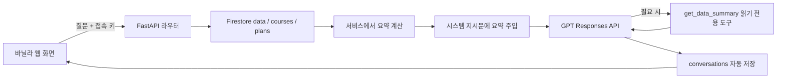

# 과제 요구사항 점검과 설명 자료

이 문서는 M1-2 필수 요구사항과 선택 보너스를 구분합니다. 허브의 외부 링크 목록과 별개로, 평가 대상 애플리케이션은 `frontend/education.html`과 `backend/app`의 강사 교육운영 비서입니다.

## 네 가지 결과물

| 결과물 | 구현 위치와 확인 방법 |
|---|---|
| 데이터 기반 AI 채팅 | `/api/chat`, `services.generate_answer`. 채팅에 질문하면 로딩과 실제 답변을 표시하고 서버가 대화를 자동 저장합니다. 오른쪽 DATA CONTEXT에서 기간·기록 수·합계·평균·범위·추세를 확인합니다. |
| 데이터 관리 | `/api/data`의 POST·GET, `/{id}`의 PUT·DELETE, 교육 실적 관리 화면. 저장 후 목록과 요약을 갱신합니다. 삭제는 원본 보존 후 활성 목록에서 제외합니다. |
| 대화 저장·복원 | POST·GET·DELETE `/api/conversations`, GET `/{id}`. 목록 응답은 messages를 제외한다고 명시하며 특정 대화 조회로 전체 메시지를 복원합니다. |
| 배포·문서화 | Render 백엔드, Vercel 바닐라 프론트엔드, `/docs` Swagger. README에 주소·실행 방법·환경변수·증빙 위치를 제공합니다. |

## 필수 항목 대조

| 요구사항 | 구현 근거 |
|---|---|
| Python 3.10 이상·venv·필수 패키지 | `backend/requirements.txt`, README 로컬 실행 |
| 최소 100개 시계열 | 실제 데이터는 비공개 Firestore에 저장. 공개 소스의 `generate_demo.py`로 독립적인 가상 120개 기록도 생성 가능 |
| 기간·개수·평균·최대·최소·추세 | `build_summary`, `/api/data/summary`, 대시보드 통계, 채팅 DATA CONTEXT |
| FastAPI 앱·CORS | `main.py`, 출처 목록을 `ALLOWED_ORIGINS`에서 읽음 |
| Firestore data·conversations | `database.py`, CRUD 및 대화 라우터. 추가 컬렉션 courses·plans·materials는 강사 기능 확장 |
| 요청 검증·예외 처리 | `models.py`, 날짜·시간 범위·메모 길이·추가 필드·NaN 검증. 401/404/422/503 처리 |
| 다섯 데이터 API | POST·GET `/api/data`, PUT·DELETE `/api/data/{id}`, GET `/api/data/summary` |
| 대화 저장·목록·삭제·전체 조회 | `routers/conversations.py`, 전체 messages는 상세 GET으로 제공 |
| 요약 → 시스템 지시문 → GPT → 자동 저장 | `routers/chat.py`와 `services.py`. 요약 API와 같은 `build_summary`를 직접 재사용하므로 서버가 자기 HTTP API를 다시 호출할 필요가 없음 |
| 실제 GPT·비용 제한 | Responses API, `store=False`, 출력 상한, 요청 시간 제한, 최대 재시도 1회. 도구 사용 시 논리적 모델 요청은 최대 2회 |
| 프레임워크 없는 프론트엔드 | HTML/CSS/JavaScript. `build.mjs`는 정적 파일 복사와 공개 API 주소 생성만 담당 |
| 입력·채팅·로딩 | `app.js`, 요청 중 보내기 비활성화, 대기 메시지·캐릭터 동작 |
| 데이터 목록·추가·수정·삭제 | 교육 실적 관리 화면과 확인 대화상자 |
| 이전 대화 목록·불러오기 | 대화 기록 카드의 ‘대화 이어가기’ |
| Render·Vercel 고정 | 배포 주소는 README 표에 명시 |
| 무료 서버 첫 요청 지연 | 연결이 8초 이상 걸리면 안내, 65초 타임아웃 시 재시도 안내 |
| 환경변수·키 보호 | 서버 비공개 설정, `.gitignore`, 프론트엔드는 API 주소만 빌드. 개인 접속 키는 탭 세션 보관 |
| Swagger | `/docs`의 Authorize에 개인 접속 키 입력 후 보호된 API 시험 가능 |
| 제출 화면 | 실제 운영자료 공개 제한에 따라 비공개 제출 폴더 README에 채팅·CRUD·복원 화면 포함. 공개 저장소에는 운영 캡처를 넣지 않음 |

## 여섯 학습목표를 설명하는 방법

1. **시계열 분석 흐름**: 원본을 날짜별 기록으로 정리하고 `date`, `value`(교육시간), `memo`를 저장합니다. 조회 기간으로 필터링하고 Python에서 통계를 계산합니다. 화면과 AI가 같은 요약 함수를 사용합니다. 교육생은 과정별 연인원이며 여러 교육일에 중복 합산하지 않습니다.
2. **라우터와 서비스 분리**: 라우터는 URL·메서드·요청·응답을 담당하고 서비스는 집계·GPT 호출을 담당합니다. 저장 접근은 `database.py`, 검증 모델은 `models.py`로 분리해 DB나 화면과 무관하게 집계 로직을 시험할 수 있습니다.
3. **Pydantic 검증**: 날짜 형식 오류, 음수·하루 24시간 초과, NaN, 빈 메모, 미정의 필드 등을 저장 전에 차단합니다. 잘못된 요청에는 422를 반환합니다. 교육시간의 0~24 범위는 이 프로젝트의 교육 기록에 맞춘 기준입니다.
4. **Firestore CRUD**: 컬렉션 안의 문서를 ID로 생성·조회·부분 갱신합니다. 삭제는 `deleted=true`로 보존하고 활성 조회와 통계에서 제외합니다. 재가져오기 도구는 기존 ID의 편집·삭제 상태를 덮어쓰지 않습니다.
5. **컨텍스트 주입**: GPT는 Firestore를 저절로 읽지 못합니다. 서버가 현재 요약 JSON을 `instructions`에 넣고 최근 사용자·AI 메시지와 함께 보냅니다. 이는 모델 재학습이 아닙니다. 요약 안의 문구를 명령으로 실행하지 않도록 지시합니다. 선택 도구 호출도 서버 계산값을 확인하는 경로입니다.
6. **CORS·환경변수·키 관리**: Vercel과 Render의 출처가 다르므로 브라우저 요청 출처를 CORS로 허용합니다. CORS는 인증을 대신하지 않습니다. 데이터 API는 별도 Bearer 접속 키로 보호하고 OpenAI·Firebase 키는 Render 환경변수에만 둡니다. Vercel의 `API_BASE_URL`은 공개 가능한 서버 주소입니다.

## 선택 보너스 범위

- 통계 확장: 연인원·서로 다른 교육일·입력 과정의 만족도 등.
- 월별 교육시간 그래프와 JSON 내보내기.
- 강사 화면의 밝게/어둡게 토글, 브라우저 테마 선택 보관.
- GPT `get_data_summary` Function Calling 및 같은 집계의 로컬 stdio MCP 조회. 연결·검증 방법은 [도구 연동 문서](tool-integration.md)를 참고합니다.

MCP는 별도 클라이언트와 서버 프로세스 간 호출을 검증하는 방식입니다. Codex·Cowork에 영구 설치하거나 공개 MCP 주소를 개설한 상태를 뜻하지 않습니다. 외부 AI 호스트별 등록은 별도 설정이며 이 구현에 필수는 아닙니다. GPT Actions는 중복 구현하지 않습니다.
