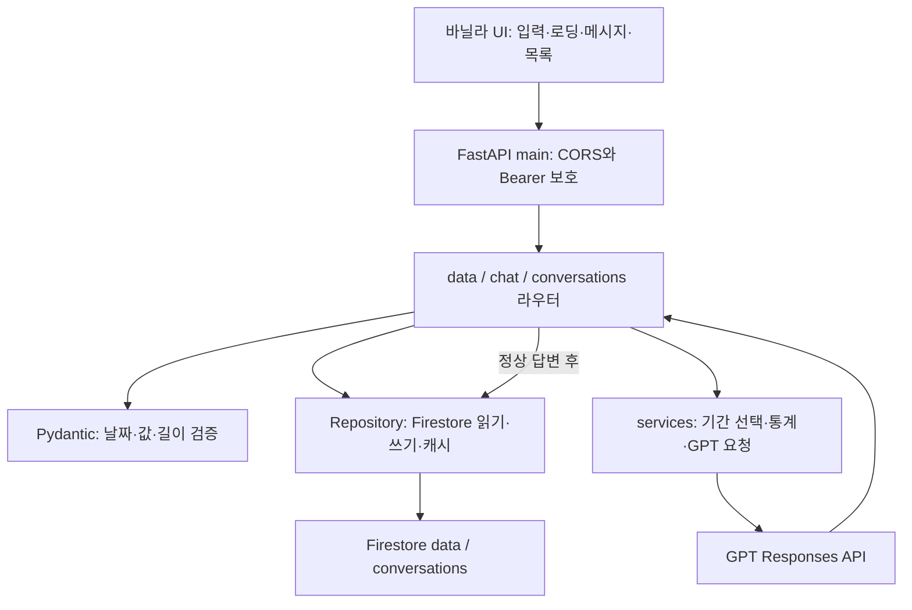

# 사전평가 18개 항목의 구현·설명·실행 증빙

평가 화면의 61%(11/18)는 당시 제출한 자료에 대한 사전평가 결과입니다. 아래는 보완 내용과 확인 방법이며 실제 재평가 점수를 대신하지 않습니다. 공개 저장소에는 코드와 일반 설명만, 비공개 제출 ZIP에는 `실행검증.md`와 운영 화면을 담습니다. 가상 예시를 실제 운영 결과로 표현하지 않습니다.

| 항목 | 확인 내용 | 코드·설명 | 비공개 ZIP 실행 근거 |
|---|---|---|---|
| 1 | 프론트·백엔드 배포 접속 | README 접속 표 | Vercel /education·Render /health HTTP 200, 배포 화면 |
| 2 | Swagger 실행 | /docs와 /openapi.json | Swagger 화면·필수 10개 메서드 확인 |
| 3 | Firestore 저장·목록 | data 라우터 → Repository → Admin SDK | 임시 POST 201·GET 목록·PUT 200·DELETE 200·Firestore 직접 재조회 |
| 4 | 데이터 요약 | services.build_summary | 필드·형식·가상 예시, 실제 통계 응답 발췌 |
| 5 | 대화 저장·불러오기 | chat 및 conversations 라우터 | 저장 목록→특정 ID 전체 messages→화면 복원 |
| 6 | 모바일 UX | styles.css·workspace.css·academy-design.css | 데스크톱 실사용 캡처. 휴대폰 실기기 터치 검증은 별도 범위 |
| 7 | 모듈 책임 분리 | 아래 호출 흐름 | 라우터·서비스·저장소·검증 모델 근거 |
| 8 | 컬렉션 설계 | 아래 설계 이유 | data와 conversations의 서로 다른 조회·저장 패턴 |
| 9 | Pydantic | models.py·아래 예시 | 음수 시간 요청 422, 정상 요청 저장 |
| 10 | 프론트 상태 흐름 | app.js refresh/renderSummary/chat-form | 요청 중 비활성화·로딩·실패 복구 설명과 기존 로딩 캡처 |
| 11 | 컨텍스트 주입 | services.generate_answer | 장점·정확도 한계·비용·민감정보 범위 |
| 12 | 요약 함수 재사용 | data.summary와 chat.chat → build_summary | 기간을 바꾸는 로컬 호출 예시 |
| 13 | 자동·수동 대화 저장 | 아래 저장 타이밍·형식 | 수동 POST 201과 기존 실제 GPT 대화의 영구 저장 재확인 |
| 14 | 환경변수·키 관리 | 아래 운영 절차 | 키 값·계정 JSON은 증빙에서 제외 |
| 15 | 콜드스타트 | 아래 실제 대응 | 대기 문구 구현. 강제 슬립 후 첫 요청 시간 측정은 미실시 |
| 16 | CORS | main.py·config.py | 허용 출처 OPTIONS 200·미허용 출처 차단 확인 |
| 17 | 입력·프롬프트 위험 | 아래 규칙·제한 | Pydantic, 읽기 전용 도구 이름·인수 검증 |
| 18 | 기간 필터·집계 | select_rows와 build_summary | 아래 작은 입력으로 합계가 달라지는 재현 예시 |

## 1~5. 실행 증거를 읽는 순서

비공개 ZIP의 `실행검증.md`에서 검사 시각, 대상 URL, HTTP 상태, 요청 본문, 반환 ID, Firestore SDK 직접 재조회, 임시 데이터 정리 결과를 확인합니다. 이어 `screenshots/`의 채팅+요약, CRUD, 목록+복원, Swagger 화면을 확인합니다. 실제 GPT 생성 시연 날짜와 이번 재조회 날짜를 구분합니다. `/health`의 `ai_configured=true`만으로 실제 GPT 생성 성공을 증명한다고 주장하지 않습니다.

과제 제출 사이트가 이미지/PDF를 분석하지 않더라도 `실행검증.md` 본문에서 실행 결과를 읽을 수 있습니다. 이미지는 사람이 볼 때를 위한 별도 증빙입니다. 키가 없는 401은 보호 동작이며, 평가 시 강사가 연결한 화면으로 시연합니다.

## 7. 라우터·서비스·저장소 분리



URL·HTTP 오류·저장 시점은 라우터, 통계와 AI 처리 규칙은 서비스, SDK·캐시·삭제 제외는 저장소에 둡니다. 예를 들어 통계 공식을 바꿀 때 화면이나 Firestore SDK 코드를 바꾸지 않고 `build_summary()`와 관련 통계 테스트를 수정합니다.

## 8. Firestore 컬렉션 설계

| 컬렉션 | 문서 단위·대표 필드 | 조회·쓰기 패턴과 선택 이유 |
|---|---|---|
| data | 교육일별 실적. date, value, memo, course_id(선택), 과목·방식·장소, deleted | 실적 추가·부분 변경, 목록·기간 통계를 자주 읽음. 대화와 독립적으로 편집 |
| conversations | 대화 1개. title, agent_id, messages, created_at, updated_at, deleted, tool_calls(자동 저장) | 제목 목록 조회 후 선택한 대화만 전체 메시지 조회. 한 문서로 복원하기 쉬움 |
| courses | 원본 과정 1개. 과정별 인원·만족도 | 여러 교육일에 과정 인원이 중복 합산되지 않도록 분리 |
| plans | 계획 1개. 날짜·시간·상태·출처·실적 연결 | 실적과 분리하고 폐강/보류/온라인 대체를 별도 관리 |
| materials / material_files | 교재 메타데이터 / 비공개 파일 | 과목 검색과 파일 보관 책임 분리 |

현재 `Repository.list()`는 컬렉션을 읽고 서버에서 활성 문서를 캐시합니다. 날짜 범위·방식·검색은 Python의 `select_rows()`가 수행하고 `limit/offset`도 필터 후 적용합니다. Firestore 범위 쿼리나 무제한 확장 구조로 설명하지 않습니다. 커지면 DB 범위 쿼리·정렬·인덱스·서버 페이지네이션으로 바꿔야 합니다.

`save()`는 `document(id).set(..., merge=...)`, 삭제는 `deleted=true` 부분 변경입니다. 삭제 문서는 활성 조회에서 제외하고 원본은 유지합니다. API가 저장에 성공하면 해당 프로세스의 목록 캐시도 갱신합니다. 외부 가져오기 변경은 기본 900초 TTL 후 반영되고 대화 목록 TTL은 최대 30초입니다.

## 9. 요청 검증과 응답 예시

다음은 형식을 설명하는 가상 예시입니다. 실제 실행 값은 비공개 `실행검증.md`에 있습니다.

```http
POST /api/data
Content-Type: application/json

{"date":"2026-10-01","value":1,"memo":"가상 실습","course_title":"가상 수업","mode":"기타","students":0}
```

정상 응답 201의 대표 형식입니다. 아래 `<문서 ID>`·`<UTC 시각>`은 자리표시자입니다.

```json
{"id":"<문서 ID>","date":"2026-10-01","value":1,"memo":"가상 실습","course_title":"가상 수업","mode":"기타","students":0,"venue":"","unit":"hours","source":"manual","approval_status":null,"deleted":false,"created_at":"<UTC 시각>","updated_at":"<UTC 시각>"}
```

`value=-1`, `value=25`, 날짜 형식 오류, 빈 메모, 2000자 초과 메모, NaN, 미정의 필드는 422입니다. `PUT`에 변경 필드가 없으면 422, 없는 ID 조회·수정은 404, 접속 키 오류는 401입니다. 이 검증은 프론트 폼과 별도로 서버에서 수행합니다. 오류 응답은 `detail`의 문자열 또는 Pydantic 오류 배열을 사용합니다.

## 10. 로딩·실패·저장 상태 흐름

연결 시 `/health`→`/api/data/summary`→`renderSummary()`로 상태와 통계를 그립니다. 질문 전송 시 `state.busy=true`, 보내기 비활성화, 대기 메시지를 표시합니다. 성공하면 assistant 메시지와 conversation_id를 반영하고 자동 저장 표시를 합니다. 실패하면 미완료 질문을 대화 배열에서 제거하고 입력칸에 복구해 재시도할 수 있게 하며, ‘저장되지 않았습니다’를 표시합니다. `finally`에서 버튼을 다시 활성화합니다. 요약을 읽지 못한 상태에서는 채팅 요청을 시작하지 않습니다.

## 11. 컨텍스트 주입의 장점과 한계

요약 API와 채팅이 같은 Python 집계 함수를 사용하므로 수치 정의를 통일할 수 있습니다. GPT는 현재 DB를 스스로 아는 것이 아니라 서버가 넣은 요약을 참고합니다. 저장·기간 변경 후 요약을 다시 계산하면 그 선택 범위를 답변 맥락으로 전달할 수 있습니다.

정확도 한계: 데이터가 빠졌거나 잘못 입력되면 답변도 영향을 받습니다. 월 중간 집계로 수요 증감을 단정하지 않습니다. `count`·교육일·과정 수·연인원을 구분합니다. 계획 세부는 최대 80개이며 `sessions_truncated`로 생략을 알립니다. 모델이 수치를 잘못 설명할 수 있어 화면 통계와 검산합니다.

비용·지연: 요약과 대화가 길수록 입력 토큰이 늘 수 있습니다. 현재 최근 12메시지, 출력 기본 1000토큰(설정 범위 100~4000), SDK timeout=45초, max_retries=1을 사용합니다. 도구 사용 시 논리적 모델 요청은 최대 2번이며 SDK 재시도로 실제 전송 횟수는 더 늘 수 있습니다. 사용자별 일일 과금 상한·월간 요청 할당량은 구현하지 않았습니다.

민감정보: 서버는 원본 PDF나 메모 전체를 일괄 전송하지 않습니다. 하지만 요약의 과목·기관명과 사용자가 입력한 질문에는 개인정보가 포함될 수 있습니다. 주민번호·연락처·개인별 출석 명단은 입력하지 않습니다. 자동 PII 탐지·삭제는 미구현이며, 사람이 비식별화하고 접근 권한을 관리해야 합니다. SDK의 `store=False` 설정을 모든 보관 정책이 없다는 의미로 설명하지 않습니다.

## 12. 요약 API 호출과 재사용

클라이언트는 `GET /api/data/summary?date_from=2026-01-01&date_to=2026-12-31`로 선택 기간의 요약을 읽습니다. 서버의 chat 라우터는 자기 HTTP 주소를 다시 호출하지 않고 동일한 `build_summary(select_rows(...))`를 직접 사용합니다. Function Calling은 허용된 `get_data_summary` 스키마와 `{}` 인수만 받아 그 요청의 서버 계산값을 확인합니다. [호출 흐름](tool-integration.md)도 참고합니다.

## 13. 대화 저장 타이밍과 형식

자동: `/api/chat`이 기존 대화 조회→사용자 메시지 추가→통계·GPT 처리→assistant 추가→`conversations` 저장을 실행합니다. GPT 오류·빈 답변·출력 한도 미완료이면 정상 assistant 대화를 저장하지 않습니다. 성공 응답은 `answer`, `conversation_id`, `saved=true`, `data_period`, `data_count`, `tool_calls`입니다.

수동: `POST /api/conversations`는 별도 저장 API입니다. GPT 호출 없이 제공한 `title/messages`를 저장합니다. `id` 생략은 새 문서, 기존 id는 해당 대화 갱신이며 없는 id는 404입니다. 웹의 별도 ‘수동 저장’ 버튼을 구현했다는 뜻은 아닙니다. 수동 저장 모델은 `tool_calls` 입력을 받지 않으며 기존 대화를 수동 덮어쓰면 과거 도구 추적을 보존하지 않는 제한이 있습니다.

```json
{"title":"가상 수동 저장","messages":[{"role":"user","content":"수동 저장 기능 확인"},{"role":"assistant","content":"GPT 생성이 아닌 저장 API 예시 메시지"}]}
```

`GET /api/conversations`는 제목·시각·agent_id·message_count만 반환하고 `messages_included=false`와 상세 경로를 명시합니다. `GET /api/conversations/{id}`는 전체 messages를 반환합니다. 프론트는 이를 `state.messages`에 복원한 뒤 `renderMessages()`로 표시합니다.

자동 저장의 도구 추적 형식은 아래와 같습니다. 도구 결과 전체와 내부 call_id를 저장하는 구조는 아닙니다. `{}` 인수와 이름 검증 후 현재 요청의 요약을 도구 결과로 전달합니다.

```json
{"name":"get_data_summary","arguments":{},"basis":"선택 기간의 교육기록 수치 확인","data_period":{"start":"2026-10-01","end":"2026-10-02"}}
```

## 14. 배포 비밀값과 키 교체 절차

OpenAI 키·서비스 계정 JSON·APP_ACCESS_TOKEN은 Render Web Service의 Environment 비공개 값으로 관리합니다. Vercel에는 공개 가능한 API_BASE_URL만 둡니다. 로컬은 Git에서 제외한 backend/.env와 자격증명 경로를 사용합니다. 저장소에 실제 키를 넣지 않습니다.

정상 교체 절차는 새 키를 서비스 공식 화면에서 준비→Render 비공개 환경변수 교체·재배포→health와 보호 API·Firestore 연결 확인→새 키로 작은 호출 1회 확인→이전 키 폐기입니다. Firebase 서비스 계정 키도 새 JSON으로 연결을 확인한 뒤 이전 키를 폐기합니다. 키 발급·삭제·권한 변경은 운영자가 직접 수행하며 이번 문서 보완 중 실제 키를 변경하지 않았습니다. 긴급 유출이면 이전 키 폐기를 우선하고 코드·로그 노출도 함께 점검합니다.

APP_ACCESS_TOKEN 교체 뒤 기존 브라우저 세션은 새 개인 접속 키로 다시 연결합니다. OPENAI_API_KEY나 Firebase JSON을 브라우저의 개인 접속 키 칸에 넣지 않습니다. 예제 파일에는 변수 이름과 자리표시자만 둡니다.

## 15. 콜드스타트 대응

프론트 연결이 8초 이상 걸리면 무료 서버가 쉬고 있었을 수 있다는 안내를 표시하고 65초 타임아웃이면 재시도 안내를 합니다. 질문 중 재전송은 비활성화합니다. 모델 답변 실패는 입력을 복원하고 저장 성공으로 표시하지 않습니다.

발표 5분 전 `/health`를 열고 교육 화면을 연결해 요약이 보이는지 확인합니다. 지연 시 약 1분 후 새로고침합니다. 이는 수동 사전 연결 절차이며 주기적 자동 워밍업이나 무중단을 구현한 상태가 아닙니다. 이번 접속 검사는 이미 동작 중인 서버였으므로 강제 슬립 후 첫 요청 지연을 측정했다고 주장하지 않습니다.

## 16. CORS 예시와 테스트

로컬 `.env`: `ALLOWED_ORIGINS=http://127.0.0.1:8010,http://localhost:8010,http://127.0.0.1:4173`

Render 운영: `ALLOWED_ORIGINS=https://candyaflex-edu-agent-hub.vercel.app`

별도 staging을 쓰면 실제 발급받은 staging 출처만 추가합니다. 경로나 비밀키를 넣거나 `*`로 대신하지 않습니다. CORS는 브라우저 출처 허용이며 인증을 대체하지 않습니다. 비공개 실행검증은 허용 출처의 OPTIONS와 미허용 출처의 응답 헤더를 각각 확인합니다.

## 17. 입력·프롬프트 위험 규칙

날짜·유한수·길이·허용 enum·미정의 필드는 Pydantic으로 검사합니다. 요약 문자열은 참고 데이터로 취급하고 안의 지시를 실행하지 않도록 규칙과 데이터 구역을 구분합니다. 도구는 `get_data_summary` 하나의 읽기 전용 기능이며 이름과 `{}` 인수를 서버에서 검증하고 병렬 호출을 끕니다. 금전 지출·외부 발송·DB 삭제를 모델 도구로 제공하지 않습니다.

사람 이름·연락처를 자동 가리는 필터나 공격 탐지 모델은 없습니다. 문구 규칙만으로 모든 악성 입력을 막는다고 주장하지 않습니다. 수치와 기간을 화면에서 확인하고 운영자가 공유 전 내용을 검토합니다.

## 18. 기간 변경·통계 변경 예시

아래 입력은 실제 교육자료와 무관한 가상 예시입니다. `select_rows()`가 범위를 고르고 `build_summary()`는 선택된 값만 계산합니다.

```python
from app.services import select_rows, build_summary
rows = [
    {"id":"demo-1","date":"2026-01-01","value":1,"memo":"가상"},
    {"id":"demo-2","date":"2026-02-01","value":3,"memo":"가상"},
]
assert build_summary(select_rows(rows, "2026-01-01", "2026-01-31"), [])['metrics']['total'] == 1
assert build_summary(select_rows(rows, "2026-01-01", "2026-02-28"), [])['metrics']['total'] == 4
```

예를 들어 평균의 반올림 자릿수를 바꾸면 `services.build_summary()`의 metrics.average 계산과 통계 기대값을 검증하는 테스트를 수정합니다. 데이터 수집이나 GPT 호출 코드를 바꿀 필요가 없습니다. 로직 변경 후 요약 API와 채팅이 같은 새 함수를 사용하게 되는 것이 분리 설계의 목적입니다.
