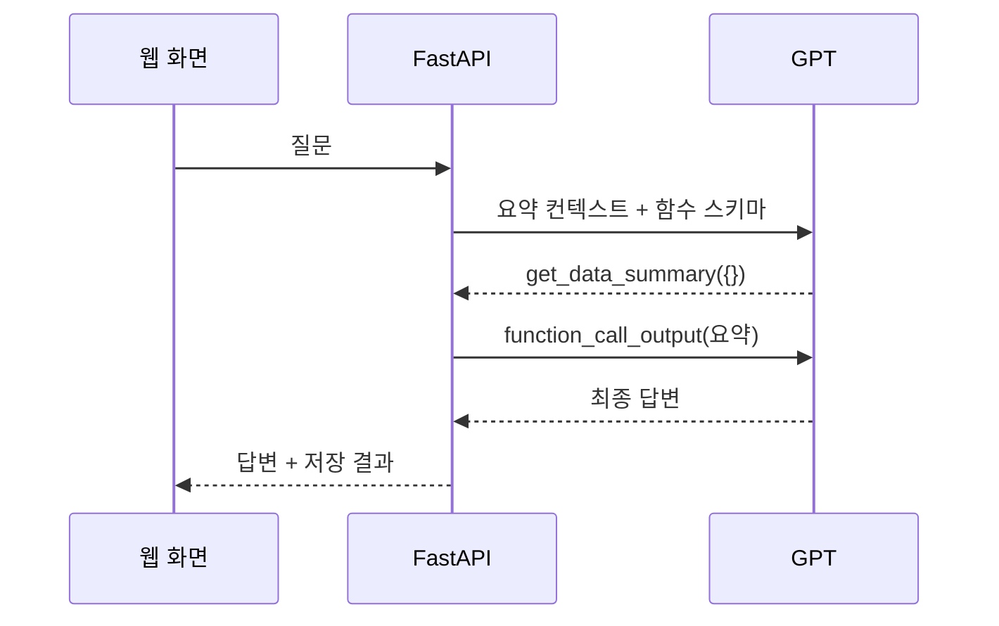

# Function Calling과 MCP 연결

GPT가 최신 기록의 수치 확인·요약 요청을 받으면 `get_data_summary`를 선택할 수 있습니다. 서버는 허용한 함수 이름과 빈 인수 객체 `{}`만 받아, 현재 선택한 분석 기간의 요약을 반환합니다. 호출 결과를 `function_call_output`으로 GPT에 전달하고 최종 답변과 호출 메타데이터를 대화 문서에 저장합니다. `tool_calls`의 `basis`는 서버가 붙인 조회 목적 설명이며 모델의 비공개 내부 추론을 기록하는 항목이 아닙니다.

1. 사용자: ‘최신 교육기록의 개수와 총 시간을 도구로 확인해 주세요.’
2. GPT: 정의된 JSON 스키마를 보고 `get_data_summary({})` 요청.
3. 서버: 현재 요약을 검증해 반환. 교육계획은 별도이고 기관별 상세 일정은 도구 결과에서 제외.
4. GPT: 결과에 근거한 답변 생성. 두 번째 요청은 `tool_choice=none`이므로 반복 도구 호출을 막음.
5. 서버: 질문·답변·도구 이름/인수/조회 기간 자동 저장.

직접 답할 수 있는 질문은 모델 요청 1회, 도구 사용 시 최대 2회입니다. 각 요청의 출력 토큰 상한은 `OPENAI_MAX_OUTPUT_TOKENS`이며 SDK 재시도는 최대 1회입니다. 모르는 함수·추가 인수·잘린 호출은 거부하고 실패를 성공 대화로 저장하지 않습니다.



## 같은 기능의 MCP 경로

`backend/mcp_server.py`는 공식 MCP SDK 2.3.0의 stdio 서버입니다. 공개 포트를 열지 않고 하나의 읽기 전용 도구만 제공합니다. 별도 클라이언트가 로컬 서버 프로세스를 시작하고 `tools/list`와 `tools/call`을 실행합니다. 서버는 사용자가 지정한 `API_BASE_URL`의 보호된 `/api/data/summary`를 기존 접속 키로 조회합니다. Firebase·OpenAI 키를 MCP 클라이언트에 전달하지 않습니다.

```text
별도 MCP 클라이언트
  → stdio MCP 서버의 get_data_summary
  → Bearer 인증된 Render /api/data/summary
  → 화면·GPT와 같은 build_summary 결과
  → 기관별 상세 일정을 제외한 요약 반환
```

저장소 루트에서 실행합니다.

```powershell
.\.venv\Scripts\python.exe -m pip install -r backend/requirements-mcp.txt
# backend/.env에 본인의 APP_ACCESS_TOKEN을 비공개로 저장해 둡니다.
$env:API_BASE_URL = 'https://candyaflex-edu-api.onrender.com'
.\.venv\Scripts\python.exe backend/scripts/verify_mcp.py
```

키를 명령행 인수·URL·공개 호스트 설정 예시에 넣지 않습니다. `verify_mcp.py`는 프로토콜·도구 목록·집계 스키마를 확인하고 운영 수치와 키를 콘솔에 출력하지 않습니다. 결과는 Git에서 제외된 `.local/verification/mcp-client.json`에 기록합니다. 실제 운영자료를 조회하므로 권한 있는 사용자만 개인 키로 실행합니다.

MCP 도구는 전체 보유 기간의 요약을 반환합니다. 웹 채팅의 GPT 도구는 현재 선택한 분석 기간의 요약을 반환합니다. 같은 전체 기간을 선택하면 집계 기준은 같습니다. 이 단계는 별도 MCP 프로토콜 클라이언트로 검증하며 Codex·Cowork의 영구 연결 설정을 변경하지 않습니다.

공식 문서: [OpenAI Function Calling](https://developers.openai.com/api/docs/guides/function-calling), [MCP Python Client](https://py.sdk.modelcontextprotocol.io/client/), [MCP stdio transport](https://py.sdk.modelcontextprotocol.io/client/transports/).
